  

# 🌐 Awesome Internet of Things (IoT) Platform Ecosystem

  
  
  
  
  
  
  

---

## 📌 Executive Summary & Architecture Scope

Welcome to the definitive, SEO-optimized repository and curated taxonomy of **Internet of Things (IoT) Platforms**, **Industrial IoT (IIoT)** middleware, **MQTT message brokers**, **digital twin frameworks**, and **edge computing runtimes**.

Whether you are architecting a planetary-scale enterprise IoT fleet, deploying edge gateways in smart factories, or configuring open-source home automation, this guide catalogs both battle-tested **commercial enterprise SaaS solutions** and high-performance **sovereign self-hosted open-source software (OSS)**.

Key technical domains covered include:
- 📡 **Bidirectional Messaging Protocols**: MQTT 3.1.1/5.0, CoAP, WebSockets, LwM2M, LoRaWAN, HTTP/2, OPC-UA, and Modbus.
- 🛡️ **Fleet & Device Provisioning**: Zero-touch X.509/mTLS certificate issuance, hardware cryptographic roots of trust (TPM/Secure Element), and remote device twin synchronizations.
- ⚡ **Industrial Edge Computing**: Store-and-forward telemetry, PLC/SCADA bridges, and Dockerized microservices on edge nodes.
- 🔄 **Over-the-Air (OTA) Updates**: Atomic A/B OS rollouts, delta updates, and canary firmware deployment pipelines.
- 📊 **Telemetry Ingestion & Time-Series Storage**: Millions of metrics/sec written into specialized time-series TSDB engines paired with real-time alerting rule engines.

---

## 📑 Table of Contents

- [📈 Sector Overview & Market Dynamics](#-sector-overview--market-dynamics)
- [☁️ SaaS / Hosted Enterprise Platforms](#️-saas--hosted-enterprise-platforms)
- [🚀 Open-Source GitHub Projects](#-open-source-github-projects)
  - [High-Throughput IoT Platforms & Digital Twins](#high-throughput-iot-platforms--digital-twins)
  - [MQTT 5.0 Brokers & Edge Gateways](#mqtt-50-brokers--edge-gateways)
  - [Smart Home, Building & Microcontroller Frameworks](#smart-home-building--microcontroller-frameworks)
  - [Time-Series Databases, Visualizations & RTOS](#time-series-databases-visualizations--rtos)
- [⭐ Star History](#-star-history)
- [💖 Support & Sponsorship](#-support--sponsorship)
- [🤝 How to Contribute](#-how-to-contribute)
- [📜 Disclaimer & Security Note](#-disclaimer--security-note)

---

## 📈 Sector Overview & Market Dynamics

The global Internet of Things (IoT) platform market is valued between **$16 billion and $24 billion** (projected to exceed $50 billion by 2030 at a **12% to 15% CAGR**), driven by rapid expansion across Industry 4.0, smart utility grids, predictive asset maintenance, and autonomous fleet telematics.

The market architecture demonstrates a distinct **dual structure**:
- **Heavily Concentrated at Infrastructure Core (Winner-Take-Most Hyperscalers)**: Public cloud hyperscalers (Amazon Web Services, Microsoft Azure, Google Cloud) command dominant revenue share for large-scale managed cloud infrastructure, centralized MQTT brokers, and multi-region device registries.
- **Highly Fragmented Across Verticals & Edge Applications**: Across vertical applications—including smart manufacturing, cellular SIM eSIM orchestration (Hologram, Cisco), connected telematics (Samsara), low-code device builders (Blynk), and industrial digital twins (PTC ThingWorx, Cumulocity)—the ecosystem is deeply fragmented. Hundreds of specialized domain platforms and self-hosted open-source frameworks (ThingsBoard, EMQX, Node-RED, Home Assistant) thrive by solving low-latency, sovereign on-premises, and deterministic edge protocol requirements.

---

## ☁️ SaaS / Hosted Enterprise Platforms

The table below provides a comprehensive comparison of leading commercial IoT SaaS platforms, including company financial scale (sorted descending by corporate valuation/revenue), precise entry-level pricing tiers, and specific free tier or trial limitations.

| Company / Product | Company Scale (Market Cap / Valuation / Revenue) | Starting Tier Pricing | Free Tier / Free Trial Limits | Key Architecture & Protocol Highlights |
| :--- | :--- | :--- | :--- | :--- |
| **[Microsoft Azure IoT Hub](https://azure.microsoft.com/services/iot-hub/)** | **$3.13 Trillion** (Market Cap) | **$10.00 / month** per unit (Basic B1 tier, 400k msgs/day) | **Permanent Free Tier (F1)**: 8,000 messages/day across up to 500 devices (0.5 KB meter size) | Enterprise-grade managed cloud message hub supporting bidirectional MQTT, AMQP, and HTTPS with native Azure Digital Twins integration. |
| **[AWS IoT Core](https://aws.amazon.com/iot-core/)** | **$2.31 Trillion** (Market Cap) | **$1.00 / million messages** (5 KB meter chunks; first 1B msgs/mo) | **12-Month Free Tier**: 2,250,000 connection minutes, 500,000 messages/mo, 250,000 rules triggered/mo (~50 devices 24/7) | Planetary-scale managed cloud gateway with high-throughput MQTT broker, Rules Engine routing, Device Shadow API, and LoRaWAN support. |
| **[Cisco IoT Control Center](https://www.cisco.com/site/us/en/products/networking/industrial-iot/control-center.html)** | **$235.78 Billion** (Market Cap) | **Quote-based / Custom** (Carrier operator contract tiered by active SIMs & pooled MBs) | **No Public Free Tier / Trial** (Requires sales evaluation and operator SIM provisioning engagement) | Global enterprise cellular IoT connectivity management platform automating real-time SIM lifecycle provisioning, fraud detection, and diagnostic analytics. |
| **[PTC ThingWorx](https://www.ptc.com/en/products/thingworx)** | **$22.50 Billion** (Market Cap) | **~$50,000 / year** (Base enterprise server license + ~$50–$200/device/year) | **30-Day Free Trial** (Hosted sandbox access via Developer Portal with limited simulated assets) | Leading Industrial IoT (IIoT) application development platform featuring native Kepware OT drivers (OPC-UA/Modbus), 3D digital twins, and predictive maintenance. |
| **[Samsara](https://www.samsara.com)** | **$18.50 Billion** (Market Cap) | **~$27.00 – $33.00 / vehicle / month** (Software license; hardware gateways ~$99–$150 upfront, 36-mo contract) | **Custom Demo / Trial** (Qualified commercial fleets can pilot hardware gateways and AI dashcams for up to 30 days) | Connected operations platform integrating real-time GPS asset telematics, AI dashcams, electronic logging devices (ELD), and heavy machinery sensor telemetry. |
| **[Software AG Cumulocity IoT](https://www.softwareag.com/en_corporate/platform/iot.html)** | **$2.60 Billion** (Acquisition Valuation by Silver Lake) | **~$600.00 / month** (Starting standard cloud tenant package or usage marketplace tier) | **30-Day Free Trial**: Full core platform features connecting up to 10 real or simulated devices | Telco-grade, open, cloud-native IoT device management and application enablement platform offering edge-to-cloud analytics and plug-and-play device drivers. |
| **[Zoho IoT](https://www.zoho.com/iot/)** | **$1.50+ Billion** (Annual Revenue, Bootstrapped) | **$30.00 – $40.00 / month** (Starting tier based on asset capacity and telemetry ingestion rate) | **30-Day Free Trial**: Complete access to industrial templates, dashboards, and automated alerts without credit card | Low-code end-to-end IoT platform tailored for smart building automation, energy monitoring, equipment health, and turnkey operations management. |
| **[Particle](https://www.particle.io)** | **~$200 Million** (Historical Valuation / Acquired by Digi Int.) | **$299.00 / month** (Growth block: includes 100 devices and 720k Data Operations) | **Permanent Free Plan**: Up to 100 devices free forever with 100,000 Data Operations/month and cellular allowance | Full-stack IoT platform pairing certified hardware modules (Wi-Fi, LTE-M, NB-IoT) with device cloud management, zero-touch mesh networking, and atomic OTA updates. |
| **[Hologram](https://www.hologram.io)** | **~$80 Million+** (Total Venture Funding Raised) | **$0.75 – $1.00 / SIM / month** base fee + **$0.03 – $0.40 / MB** pay-as-you-go data | **Pilot SIM Starter Kit**: 1 test SIM with 1 MB of free global cellular data for 30 days upon activation | Global cellular IoT connectivity platform providing software-defined multi-network eUICC SIM cards, automated carrier switching across 470+ networks, and REST APIs. |
| **[Blynk](https://blynk.io)** | **~$10 Million – $20 Million** (Estimated Corporate Scale) | **$29.00 / month** (Starter plan, up to 10 active devices, billed annually) | **Permanent Free Plan**: 5 devices, 1 organization user, standard widgets, and community support | Low-code IoT software suite offering drag-and-drop iOS/Android mobile dashboard builders, web portals, device provisioning, and remote firmware deployment. |

---

## 🚀 Open-Source GitHub Projects

The open-source ecosystem provides sovereign control, local offline operation, and custom extensibility. Below are top-tier projects organized by core architectural role and sorted in descending order by **GitHub Star Count**.

### High-Throughput IoT Platforms & Digital Twins

| Project & Repo Link | Star Count | Architecture & Tech Stack | Description |
| :--- | :--- | :--- | :--- |
| **[ThingsBoard](https://github.com/thingsboard/thingsboard)** |  | Java, Netty, Akka, PostgreSQL/Cassandra | Flagship enterprise-grade open-source IoT platform for device telemetry collection, rule chains, device shadows, alarms, and customizable rich real-time dashboards. |
| **[Mainflux / Magistrala](https://github.com/absmach/magistrala)** |  | Go, NATS, Redis, PostgreSQL | Secure, scalable microservices-based IoT platform bridging MQTT, CoAP, HTTP, and WebSocket messages with fine-grained RBAC and multi-tenancy. |
| **[OpenRemote](https://github.com/openremote/openremote)** |  | Java, Keycloak, PostgreSQL, Docker | 100% open-source IoT asset management platform designed for smart city grids, fleet operations, building management, and edge automation. |
| **[EdgeX Foundry](https://github.com/edgexfoundry/edgex-go)** |  | Go, Microservices, C | Vendor-neutral, LF Edge open-source industrial edge computing framework interconnecting legacy OT protocols (Modbus, BACnet, OPC-UA) with IT cloud endpoints. |
| **[Kaa IoT Community](https://github.com/kaaproject/kaa)** |  | Microservices, Java, Go | Flexible open-source enterprise IoT middleware providing device registry, telemetry analytics, real-time alert dispatching, and hardware provisioning. |
| **[Mender](https://github.com/mendersoftware/mender)** |  | Go, C, Yocto, Embedded Linux | Robust open-source over-the-air (OTA) software and firmware updater for embedded Linux devices with atomic dual A/B rootfs rollback safety. |
| **[ChirpStack](https://github.com/chirpstack/chirpstack)** |  | Rust, PostgreSQL, Redis | Open-source LoRaWAN Network Server stack offering gateway management, device provisioning, adaptive data rates (ADR), and MQTT/HTTP data forwarders. |
| **[Eclipse Ditto](https://github.com/eclipse-ditto/ditto)** |  | Java, Akka, MongoDB | Open-source Digital Twin framework providing a uniform API layer to access, synchronize, and control physical IoT hardware states. |
| **[Eclipse hawkBit](https://github.com/eclipse/hawkbit)** |  | Java, Spring Boot, MySQL | Domain-independent back-end solution for rolling out software updates to constrained edge controllers, microcontrollers, and IoT devices. |
| **[Eclipse Kura](https://github.com/eclipse/kura)** |  | Java, OSGi | Extensible open-source IoT edge middleware framework offering field protocol connectivity (Modbus, OPC-UA, CANbus) and remote gateway administration. |
| **[Eclipse Hono](https://github.com/eclipse-hono/hono)** |  | Java, Quarkus, AMQP | Cloud-native remote IoT communication layer exposing uniform telemetry and command-and-control APIs across MQTT, AMQP, CoAP, and HTTP. |
| **[Eclipse Kapua](https://github.com/eclipse/kapua)** |  | Java, OSGi, JPA | Modular open-source IoT cloud service framework managing edge device registries, message brokers, and payload data persistence. |

---

### MQTT 5.0 Brokers & Edge Gateways

| Project & Repo Link | Star Count | Architecture & Tech Stack | Description |
| :--- | :--- | :--- | :--- |
| **[EMQX](https://github.com/emqx/emqx)** |  | Erlang/OTP, RocksDB, QUIC | Ultra-scalable distributed open-source MQTT 5.0 broker capable of sustaining 100M+ concurrent IoT device connections with sub-millisecond packet latency. |
| **[Eclipse Mosquitto](https://github.com/eclipse/mosquitto)** |  | C, epoll | Featherweight, ubiquitous open-source MQTT broker (v3.1.1 and v5.0) engineered for low-memory footprint edge boards and single-board servers. |
| **[VerneMQ](https://github.com/vernemq/vernemq)** |  | Erlang/OTP, LevelDB | High-performance, distributed MQTT message broker designed for fault-tolerant horizontal clustering across cloud and on-premise nodes. |
| **[NanoMQ](https://github.com/emqx/nanomq)** |  | C, NNG | Ultra-lightweight edge computing MQTT 5.0 broker and message bus built for resource-constrained embedded systems and POSIX POSIX-compliant gateways. |
| **[Apache PLC4X](https://github.com/apache/plc4x)** |  | Java, C++, Go, Python | Universal industrial protocol adapter library communicating directly with Siemens S7, Modbus, Allen-Bradley, and Beckhoff PLCs without proprietary vendor drivers. |
| **[node-opcua](https://github.com/node-opcua/node-opcua)** |  | TypeScript, Node.js | Pure TypeScript implementation of the complete OPC Unified Architecture (OPC-UA) protocol for Industry 4.0 factory automation servers and clients. |
| **[HiveMQ CE](https://github.com/hivemq/hivemq-community-edition)** |  | Java, Netty | Fast, standards-compliant open-source MQTT 3.x and MQTT 5.0 broker built on an extensible Java plugin architecture. |

---

### Smart Home, Building & Microcontroller Frameworks

| Project & Repo Link | Star Count | Architecture & Tech Stack | Description |
| :--- | :--- | :--- | :--- |
| **[Home Assistant](https://github.com/home-assistant/core)** |  | Python, Asyncio, WebSockets | World's premier open-source local-first smart home and IoT automation platform supporting 2,500+ device integrations without cloud telemetry tracking. |
| **[Node-RED](https://github.com/node-red/node-red)** |  | Node.js, Flow-based GUI | Visual, browser-based flow-based programming tool for wiring together hardware devices, MQTT brokers, REST APIs, and industrial automation services. |
| **[ESPHome](https://github.com/esphome/esphome)** |  | C++, Python, YAML | Declarative firmware system allowing users to configure ESP8266, ESP32, and RP2040 microcontrollers through simple YAML files with native Home Assistant integration. |
| **[openHAB](https://github.com/openhab/openhab-core)** |  | Java, OSGi | Vendor-agnostic, open-source home and smart building automation platform supporting KNX, Z-Wave, EnOcean, and hundreds of consumer IoT standards. |

---

### Time-Series Databases, Visualizations & RTOS

| Project & Repo Link | Star Count | Architecture & Tech Stack | Description |
| :--- | :--- | :--- | :--- |
| **[Grafana](https://github.com/grafana/grafana)** |  | Go, TypeScript, React | The premier open-source interactive data visualization, telemetry dashboarding, and alerting engine for time-series metric databases. |
| **[InfluxDB](https://github.com/influxdata/influxdb)** |  | Rust, Apache Arrow, DataFusion | High-throughput open-source time-series database optimized for high-write-volume IoT telemetry, automated downsampling, and sub-second analytical queries. |
| **[TimescaleDB](https://github.com/timescale/timescaledb)** |  | C, PostgreSQL Extension | Powerful relational time-series SQL database built on PostgreSQL, enabling relational joins across device metadata and billions of sensor telemetry records. |
| **[Telegraf](https://github.com/influxdata/telegraf)** |  | Go, Plugin-driven | Plugin-driven server agent for collecting, parsing, transforming, and forwarding sensor metrics from MQTT, Modbus, OPC-UA, and system hardware. |
| **[QuestDB](https://github.com/questdb/questdb)** |  | Java, C++, SIMD Optimization | Blazing-fast open-source SQL database for real-time sensor metrics and financial event data with native InfluxDB line protocol support. |
| **[Zephyr RTOS](https://github.com/zephyrproject-rtos/zephyr)** |  | C, CMake, DeviceTree | Scalable, real-time operating system (RTOS) hosted by the Linux Foundation with built-in networking stacks (IPv6, BLE 5.4, Thread, MQTT, LwM2M). |
| **[RIOT-OS](https://github.com/RIOT-OS/RIOT)** |  | C, POSIX-compatible | The friendly operating system for the Internet of Things, providing microkernel architecture, low power footprint, and complete multi-threading. |
| **[FreeRTOS](https://github.com/FreeRTOS/FreeRTOS-Kernel)** |  | C, Assembly | Market-leading real-time operating system kernel for microcontrollers and small microprocessors trusted across billions of connected microchips. |

---

## ⭐ Star History

Track the community growth and adoption trajectory of this curated IoT platform repository:

---

## 💖 Support & Sponsorship

If you find this curated Internet of Things platform roadmap helpful for your engineering architecture, research, or connected hardware deployments:
- ⭐ **Star this repository** to bookmark it and help others discover it.
- 🍴 **Fork the repo** to benchmark your own custom stack integrations.
- 📢 **Share with your colleagues**, embedded hardware teams, and DevOps networks.
- ☕ **Support the maintainer**: Buy a coffee or sponsor development via the [GitHub Sponsors Dashboard](https://github.com/sponsors/ishandutta2007).

Your sponsorship helps keep device compatibility matrices, protocol updates, and pricing benchmarks fresh and accurate!

---

## 🤝 How to Contribute

We welcome contributions from embedded engineers, cloud architects, and IoT enthusiasts worldwide!

1. 🍴 **Fork the repository** on GitHub.
2. 🌿 **Create a descriptive feature branch** (`git checkout -b feature/add-new-iot-framework`).
3. 📝 **Add or update an entry** in `README.md`:
   - Follow the established markdown table format.
   - For SaaS products: Provide verifiable starting tier pricing, explicit free tier / trial terms, and corporate financial scale.
   - For Open-Source projects: Include the GitHub repository link, official social star badge (`style=social&color=white`) pointing to `/stargazers`, and primary architectural stack details.
4. 🚀 **Commit your modifications** with a clear commit message.
5. 📬 **Submit a Pull Request (PR)** detailing the justification and official documentation source.

---

## 📜 Disclaimer & Security Note

- **Community-Curated**: This repository is a community-driven catalog compiled for architectural research and education. Product names, logos, and brands are property of their respective owners.
- **Hardware Security Best Practices**: Connected IoT hardware in production environments should enforce hardware root-of-trust, encrypted firmware updates (secure boot), TLS 1.3/mTLS cryptographic authentication, and network isolation from public WAN exposure.
- **Broker Hardening**: Deploying self-hosted MQTT brokers in mission-critical environments requires clustering, persistent storage partitions, authentication plugins, and strict rate-limiting policies to prevent telemetry flooding.

---

  <b>Built with ❤️ for IoT architects, embedded software engineers, industrial automation builders, and hardware makers.</b> 
  Let's build resilient, secure, and sovereign connected device infrastructure.

